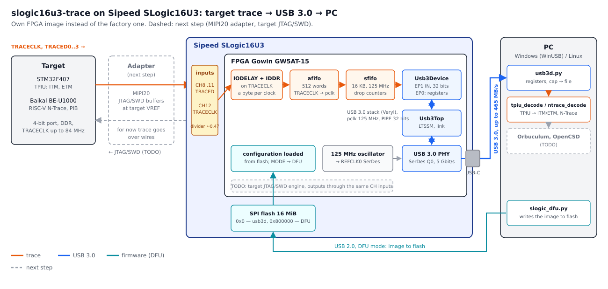

# slogic16u3-trace

**Parallel trace receiver for ARM Cortex-M and RISC-V on the Sipeed SLogic16U3: a continuous stream to the PC over
USB 3.0.**

An open FPGA image for the Sipeed SLogic16U3 logic analyzer (Gowin GW5AT-15) that captures a 4-bit DDR trace port
(ARM TPIU or RISC-V PIB) and streams it to the PC over USB 3.0, plus the host tools to record and decode it.
BSD-3-Clause.

## What and why

A debugger shows where the CPU stopped. Trace shows what it actually did: every branch, every interrupt, every
reaction time. Cortex-M has the TPIU port for it (ITM, ETM), RISC-V has PIB (N-Trace): 4 data lines and a clock,
data on both edges. Open receivers are rare: [ORBTrace](https://github.com/orbcode/orbtrace) is not for sale, and
commercial probes are expensive.

slogic16u3-trace turns the inexpensive off-the-shelf **Sipeed SLogic16U3** logic analyzer into such a receiver. It
already has all the hardware: a Gowin GW5AT-15 FPGA with SerDes, USB 3.0 on that FPGA, 16 inputs. The factory
firmware is encrypted, so this project brings its own: a different FPGA bitstream, no opening or modding of the
analyzer.

What works today:

- **Trace capture on the target's TRACECLK**: IDDR on both edges, a separate IODELAY (~12.5 ps steps) on each
  line. Verified: STM32F407 (TPIU, ITM and ETM) clean up to TRACECLK 57 MHz on the analyzer's stock wires, RISC-V
  Baikal BE-U1000 (N-Trace) at 25 and 50 MHz.
- **USB 3.0 SuperSpeed** with an open stack on the Gowin USB 3.0 PHY: up to **465 MB/s** to the PC without
  errors; Windows installs the WinUSB driver by itself (MS OS 2.0 descriptors).
- **Trace streaming over USB 3.0**: IDDR → FIFO → EP1 IN, word and drop counters, TRACECLK frequency meter,
  registers over EP0. BE-U1000 at 50 MHz: 1 GB of trace in 20 s without a single loss or error; STM32F407 at
  50 MHz: ITM and ETM decode across the whole capture.
- **Decoding on the PC**: TPIU → ITM/ETM (ETMv3 decoder following OpenCSD rules) and RISC-V N-Trace with program
  path reconstruction from the ELF.
- **No mods, no programmer**: the image is written to the analyzer's flash over USB through the factory DFU loader,
  the MODE button gets back to DFU, the factory firmware is restored from a dump.

## How it works



The target drives its trace port into analyzer inputs CH8..CH12: TRACED0..3 and TRACECLK. TRACECLK goes to a global
clock net of the FPGA, the data lines through IODELAY into IDDR: one byte per TRACECLK cycle, four bytes make a
32-bit word. Words cross into the USB clock domain (125 MHz) through an async FIFO, collect in a 16 KB FIFO and
leave through endpoint EP1 IN at a word per clock: up to 500 MB/s inside and about 465 MB/s on the bus. Drops (if
the PC does not keep up) are counted to the word at every stage. On the PC `usb3d.py` writes the stream to a file
and the decoders parse TPIU/ITM/ETM or N-Trace.

The image lives in the analyzer's flash at `0x0`, the factory DFU loader at `0x800000`; the image carries a
multiboot jump to the loader, so the MODE button always returns the analyzer to DFU. The flash is written over USB,
no programmer needed.

## Getting started

### What to buy

| What | Why |
|---|---|
| [Sipeed SLogic16U3](https://wiki.sipeed.com/hardware/en/logic_analyzer/slogic16u3/index.html) | the receiver |
| USB-C cable with SuperSpeed lines (the one in the box) | USB 3.0: a "charging" cable gives USB 2.0 only and the link will not come up |
| A target with a 4-bit trace port, see [boards](boards/) | trace source |

### What to install

| What | Used for |
|---|---|
| Python 3: `pip install libusb1 numpy pyusb` (Windows: also `libusb-package`) | flash over DFU, capture |
| [Gowin EDA](https://www.gowinsemi.com/en/support/download_eda/) 1.9.12.04 (license for GW5AT) | building the image yourself; the scripts run the Windows install from WSL |
| [OSS CAD Suite](https://github.com/YosysHQ/oss-cad-suite-build), [Veryl](https://veryl-lang.org) 0.22 | simulation and lint; Veryl also for the build |

A ready image is attached to every [release](https://github.com/radiolok/slogic16u3-trace/releases): building is
optional.

### Load and run

```sh
# MODE button -> DFU (359f:30f1, LED blinks red)
python tools/slogic_dfu.py dump slogic16u3-factory.bin          # once: full dump of your unit, keep it
python tools/slogic_dfu.py write usb3d.bin --backup slogic16u3-factory.bin   # ~50 s, verified
# replug USB -> 1209:0001 at 5 Gbit/s; MODE gets back to DFU; factory firmware: slogic_dfu.py restore
python tools/usb3d.py                                            # link, TRACECLK frequency, counters
python tools/usb3d.py --dly 208 208 208 208 cap -s 5 -o run.bin  # trace to a file
python tools/ntrace_decode.py decode run.bin --elf trace.elf     # RISC-V N-Trace
python tools/tpiu_decode.py show run.bin --elf trace.elf         # ARM TPIU: ITM and ETM
```

IODELAY depends on the target and wiring: 208 for BE-U1000, 40 for STM32F407 (see [boards](boards/)).
On Windows run the tools with Windows Python: both DFU and the trace stream use WinUSB, no extra drivers.

Wiring: TRACED0..3 → CH8..CH11, TRACECLK → CH12, ground to a GND pin of the input header.

| Signal | SLogic16U3 | FPGA ball |
|---|---|---|
| TRACED0 | CH8 | N11 |
| TRACED1 | CH9 | P11 |
| TRACED2 | CH10 | N10 |
| TRACED3 | CH11 | P10 |
| TRACECLK | CH12 | N9 (global clock input) |
| GND | GND | |

### Build

```sh
sh rtl/build.sh          # Gowin IP from your EDA, 4 placements in parallel -> build/usb3d.bin, build/usb3d.fs
sh rtl/sim/lint.sh       # Verilator -Wall
sh rtl/sim/run.sh        # testbenches
python3 -m unittest discover tools/test
```

For development the image is easier to load into SRAM over the FPGA JTAG (JST SH 8-pin connector on the board,
FT2232H, `openFPGALoader -m build/usb3d.fs`); `tools/debug/u3status.py` then reads the USB link state and packet
log over the same JTAG. Not needed for normal use.

## Target JTAG and SWD: next step (TODO)

Today the analyzer only receives trace; the target is debugged with its own debugger. The next step is an adapter
for SLogic16U3 with a full **MIPI20** connector (Cortex Debug+ETM / RISC-V Trace connectors) and JTAG/SWD buffers.

The idea: the FPGA can drive the same CH inputs as outputs. Behind the input divider (~0.47) the header sees about
1.2 V instead of the full level: enough to switch a buffer on the adapter through an "anti-divider", and the buffer
then drives the target at its VREF. Return lines (TDO, SWO) come into CH inputs like the trace does now.

- [ ] Measure the FPGA output level and edges at the header through the divider; choose a buffer (threshold, VREF supply)
- [ ] Adapter: MIPI20, TCK/TMS/TDI/nRST buffers with direction control, VREF 1.2–3.6 V, protection
- [ ] JTAG/SWD engine in the FPGA, command channel over USB 3.0
- [ ] PC protocol: CMSIS-DAP v2 (OpenOCD, pyOCD, probe-rs as is) or an OpenOCD driver
- [ ] External event marks (GNSS PPS) on the trace timeline, via a CH input

## Status

- [x] Own image loads into SLogic16U3 (flash over DFU, SRAM over JTAG), the analyzer returns to factory firmware
- [x] usb3d image to flash over DFU from Windows, no JTAG: boots on power-up, MODE gets back to DFU
- [x] Input mapping: all 16 channels, input settings
- [x] Trace capture on TRACECLK: STM32F407 up to 57 MHz, BE-U1000 at 25 and 50 MHz
- [x] USB 3.0 SuperSpeed: 465 MB/s, 125 MHz timing met
- [x] Trace stream over USB 3.0 (`usb3d`): verified with the test source
- [x] Trace stream over USB 3.0 from a real target: BE-U1000 (N-Trace, 50 MHz), 20 s without losses
- [x] STM32F407 (TPIU: ITM + ETM) over USB 3.0 at 50 MHz; ~1 error per 2M words from the wire harness, an adapter is needed
- [x] CI (lint, testbenches, decoder tests) and released image
- [ ] TRACECLK above 50 MHz over USB 3.0 (adapter instead of loose wires)
- [ ] Capture without host pauses (WinUSB with RAW_IO, or Linux)
- [ ] IODELAY sweep tool on usb3d
- [ ] 1- and 2-bit port modes
- [ ] Bridge to Orbuculum and OpenCSD
- [ ] Target JTAG/SWD (see above)

## Repository layout

| Path | Contents |
|---|---|
| [`rtl/`](rtl/) | FPGA image `usb3d`: top, stream FIFOs, constraints, build, simulation and lint |
| [`rtl/tpiu/`](rtl/tpiu/) | trace port receiver (IODELAY + IDDR → 32-bit words), usable on its own |
| [`rtl/usb/`](rtl/usb/) | USB 3.0 device stack (Veryl) and Gowin IP generator inputs |
| [`tools/`](tools/) | PC side: DFU flashing, capture, TPIU/ITM/ETM and N-Trace decoders, debug tools, target firmware |
| [`boards/`](boards/) | supported targets: wiring and settings |

## Licenses

- Code, gateware, software: [BSD-3-Clause](LICENSE).
- `rtl/usb/`: USB 3.0 stack and reference board files from [ciniml/fpga_samples](https://github.com/ciniml/fpga_samples)
  (Kenta Ida), Boost Software License 1.0, with changes (marked `rln:`).
